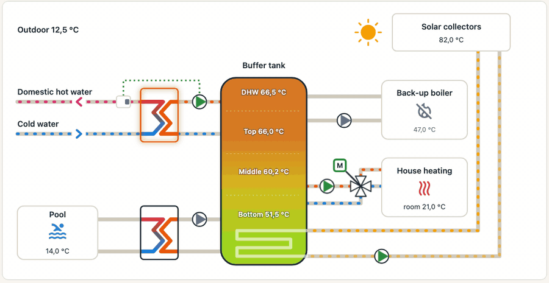

# ÖkoFEN Portal for Home Assistant

[](https://my.home-assistant.io/redirect/hacs_repository/?owner=lenoxys&repository=ha-oekofen-portal&category=integration)

Bring your ÖkoFEN heating system (Pellematic, Touch controller) into Home Assistant through your **my.oekofen.info** account: thermostats, hot water, burner, solar circuit, weather, an animated view of the installation, and a solar boost that heats the house with free solar heat on sunny days.

> **Unofficial.** Not affiliated with or endorsed by ÖkoFEN. It uses the same web API as the portal's own web app, with your own account, and ÖkoFEN can change it at any time. Use at your own risk.

<p align="center">
  <picture>
    <source media="(prefers-color-scheme: dark)" srcset="docs/panel-dark.gif">
    
  </picture>
</p>

<p align="center"><em>The ÖkoFEN panel replaying yesterday: solar pump, buffer tank, a short burner run, sunset.</em></p>

## Features

- **Thermostats and hot water**: one `climate` entity per heating circuit and one `water_heater` per hot water circuit, with mode and target temperature.
- **What the controller's local interface does not give**: the burner of the existing boiler (on / off, start and stop events with run time), the boiler temperature, the heating mixing valve.
- **Everything else the portal knows**: about 440 values on a typical installation (temperatures, pumps, status, pellet boiler, weather), grouped into one device per circuit. Most are disabled by default; enable the ones you need.
- **ÖkoFEN sidebar panel**: a live, animated schematic of the installation, a replay of yesterday and today, a history chart and the solar boost dashboard.
- **Solar boost** (experimental): on sunny days, raises the comfort temperature and opens your radiator valves so the house is heated by the solar buffer tank instead of the boiler.
- **A few safe settings** you can change from Home Assistant: solar discharge, heating curve, buffer overshoot, summer / winter mode, eco mode.
- **Readable names in your language**: English, French, German, Spanish, Portuguese, Japanese and Simplified Chinese, with ÖkoFEN's own help texts and status messages.
- **Optional local mode**: if your Touch controller's local JSON interface is enabled, the main temperatures and pumps are read locally every 10 seconds.

## Requirements

- An ÖkoFEN installation connected to **my.oekofen.info** (you can log in to the portal and see your installation).
- Home Assistant with [HACS](https://hacs.xyz/).
- Internet access (the portal is a cloud service).

## Installation

1. Click the button above, or in HACS open ⋮ → **Custom repositories**, add `https://github.com/lenoxys/ha-oekofen-portal` with type **Integration**.
2. Download **ÖkoFEN Portal** in HACS and restart Home Assistant.
3. Go to **Settings → Devices & services → Add integration**, search for **ÖkoFEN Portal**.
4. Enter your my.oekofen.info username and password.
   - Optional: the controller's local address (for example `192.168.0.10`) and its local password, or the full local URL shown on the Touch screen. Leave empty to use the portal only.

To change the account or the local address later: **ÖkoFEN Portal → ⋮ → Reconfigure**. If the portal refuses your password, Home Assistant asks you to sign in again.

## What you get

| Entity | What it shows | You can change |
|---|---|---|
| **Climate** (one per heating circuit) | Room temperature, comfort target, mode (off / auto / heat), preset (comfort / eco), *heating* when the circuit pump runs | Mode, preset, comfort target |
| **Water heater** (one per hot water circuit) | Tank temperature, target, operation (off / auto / forced) | Operation, target |
| **Burner** binary sensor and **Burner** event | Burner of the existing boiler; events *started* and *stopped* (with boiler temperature and run time) | – |
| **Boiler temperature**, **Heating mixing valve** | Existing boiler sensor; valve stopped / opening / closing | – |
| **Weather** | The controller's own weather and 3-hourly forecast | – |
| **Solar boost** switch and state sensor | See [Solar boost](#solar-boost-experimental) | On / off |
| **Scenes**: *Solar priority*, *Default values* | Apply several solar discharge settings at once (experimental) | – |
| **Pump running** binary sensors | Every pump that reports a speed | – |
| **Settings** (number / select) | See [Settings you can change](#settings-you-can-change) | Yes, within safe bounds |
| **Sensors** | Every other value of the controller, disabled by default | – |

**Devices**: one device per circuit or function (Heating circuit 1, Hot water 1, Buffer 1, Solar circuit 1, Existing boiler, Weather…), under a main *ÖkoFEN* device. Only equipment your controller really has is created.

**Enable more values** in **Settings → Devices & services → ÖkoFEN Portal → Entities**. Every entity has a `description` attribute explaining it (ÖkoFEN's own help text when there is one). Status values are shown as ÖkoFEN's own messages, for example *Comfort mode active | Room temperature reached*.

## ÖkoFEN panel

An **ÖkoFEN** entry appears in the sidebar, for every user. It follows your profile language and the light / dark theme.

- **Installation**: an animated schematic (solar collectors, buffer tank with its four sensors, back-up boiler, heating circuit with its mixing valve, hot water exchanger, pool exchanger). Pumps turn, pipes flow, the burner flame lights up, the sky shows the controller's weather (sun, moon, clouds, rain, snow, storm, fog, sunrise and sunset). Hover any element for its values.
  Under the schematic, the **replay bar** plays yesterday and today back: press ▶, drag the handle, or press **Now** to go back to live. Burner and solar pump runs are marked on the track.
- **Solar optimisation**: the state of the solar boost, every condition with its current value and threshold, and a button to turn it on or off.
- **History**: today and yesterday, with the tank, collector, flow, room and outdoor temperatures, and lanes for the burner, the pumps and the solar boost. Click a legend entry to hide a curve.

The replay and history show the last 48 hours from Home Assistant's own history (the recorder), so yesterday is there as soon as the panel's entities have been recorded. These entities (burner, buffer tank, collector, flow, room, outdoor, pumps, weather, solar boost) are enabled by default on new installs; if you installed before v0.13.0, enable any that are still disabled in **Settings → Devices & services → ÖkoFEN Portal → Entities**. The schematic is one fixed layout (buffer tank with a solar coil, hot water by plate exchanger, pool exchanger); parts your controller does not report show "–".

## Solar boost (experimental)

On sunny days, the buffer tank often holds more solar heat than the house uses. The solar boost spends it: it **raises the comfort temperature** (24 °C by default) and **opens the radiator valves you choose**, so the house stores heat in its walls during the day and needs less heating in the evening, without starting the boiler.

ÖkoFEN's own *solar discharge* function cannot do this on most installations: it starts at 82 °C, does not protect the hot water reserve, ignores the sunset and does not control thermostatic radiator valves.

**Turn it on**: first open **ÖkoFEN Portal → Configure** and pick your radiator valves (any `climate` entities), then turn on the **Solar boost** switch. It is off by default.

**It starts** when all of these are true: the burner is off, heating is on, it is between 2 hours after sunrise and 1 h 30 before sunset, the forecast is sunny (under the controller's own cloud limit), it is colder outside than the heating limit, the top of the buffer tank is hot enough that raising the comfort will not call the boiler, the hot water keeps its reserve (55 °C by default), and the room is below the target.

**It stops** and puts back your comfort temperature and radiator valves as soon as one condition is no longer met, and **immediately if the burner starts**. If you change the comfort temperature yourself during a boost, your value is kept and the boost does not start again that day; a radiator valve you changed is left alone. After a restart, the integration first puts everything back.

**Follow it** in the panel's *Solar optimisation* tab, or with the **Solar boost state** sensor (*off*, *waiting*, *boosting*, *restoring*; the `reason` attribute says what it is waiting for).

**Options** (**ÖkoFEN Portal → Configure**):

| Option | Default |
|---|---|
| Comfort temperature during the boost | 24 °C |
| Buffer top temperature to start | computed from your heating settings |
| Hot water reserve kept | 55 °C |
| Start after sunrise / stop before sunset | 120 / 90 min |
| Radiator valves to open | none |

The room settles at the comfort temperature **plus the controller's own offsets** (remote control offset, eco mode on sunny days), so it may stay a few degrees under the target. Try it on one sunny day first and watch the panel.

## Settings you can change

A short list of settings is available as number and select entities (configuration category). Every value has safe bounds, and safety settings (collector protection, maximum boiler temperatures) are deliberately not included.

| Setting | Range |
|---|---|
| Solar discharge heating: start / stop, mode (schedule / solar pump) | 40-90 / 30-90 °C |
| Solar discharge hot water: start / stop | 40-90 / 30-90 °C |
| Buffer overshoot above flow setpoint | 0-15 K |
| Heating flow temperature max / min | 30-75 / 15-40 °C |
| Heating curve base point / slope | 20-60 °C / 0.2-3.5 |
| Heating limit outdoor temperature, comfort / setback | 10-30 / 5-25 °C |
| Eco mode, heating / hot water | off, comfort, intermediate, ecological |
| Summer / winter mode | winter (heating and hot water) or summer (hot water only) |

**You are changing the settings of your heating system.** Note the values before changing them. The portal and the controller's screen show the same settings, so you can always set them back there.

## Data updates

- Main values (temperatures, pumps, burner, thermostats): every **30 seconds** from the portal, or every **10 seconds** from the local interface if configured.
- Everything else: every **5 minutes**.
- If the portal does not answer, the integration retries after 10, 20, 30 and 60 seconds, then every 5 minutes, then every 15 minutes.
- Settings are written through the portal and shown at once; the next update confirms them.

## Known limitations

- Only the first installation of the account is used.
- The settings you can change are those of heating circuit 1 and hot water circuit 1 (thermostats work on every circuit).
- Text values of the controller are not exposed.
- Needs the portal to be online, even with the local interface (burner, writes and most values only come from the portal).
- The translations other than English and French were machine-translated: corrections are welcome.

This integration **complements** integrations of the controller's local interface, such as [Ökofen Pellematic Compact](https://github.com/dominikamann/oekofen-pellematic-compact): use both if you like.

## Troubleshooting

To see what the integration does, add this to `configuration.yaml` and restart:

```yaml
logger:
  logs:
    custom_components.okofen_portal: debug
```

Then check **Settings → System → Logs**. Please include the relevant lines (without your password) when you [open an issue](https://github.com/lenoxys/ha-oekofen-portal/issues).

## Removing the integration

1. If the solar boost is running, turn it off (your comfort temperature and radiator valves are put back).
2. **Settings → Devices & services → ÖkoFEN Portal → ⋮ → Delete**.
3. Remove it from HACS and restart Home Assistant.

## License

MIT
