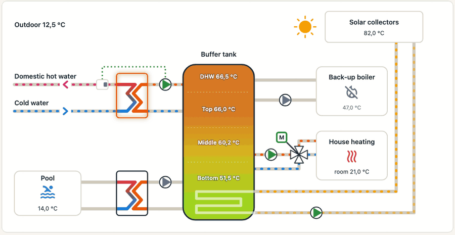

# ÖkoFEN Portal for Home Assistant

A Home Assistant integration for ÖkoFEN Pellematic heating systems through the my.oekofen.info portal, with the controller's local JSON interface as the first path when it is configured.

Installation, entities and the solar boost are described in the [README](https://github.com/lenoxys/ha-oekofen-portal#readme). These pages describe the controller itself:

- [Parameters and nomenclature](parameters.md): how to reach the values, how the variables are named, scales, modes, status bits and schedules, and a German glossary.
- [Variable reference](variables.md): every variable of the portal, with its English name, its local JSON field and what the integration does with it.
- [Local JSON interface](local.md): every field of the controller's local interface, with its unit, factor, bounds and portal name.

Unofficial: not affiliated with ÖkoFEN. Everything here was observed on a Pelletronic Touch (JSON interface V4.00b); other versions may differ.
